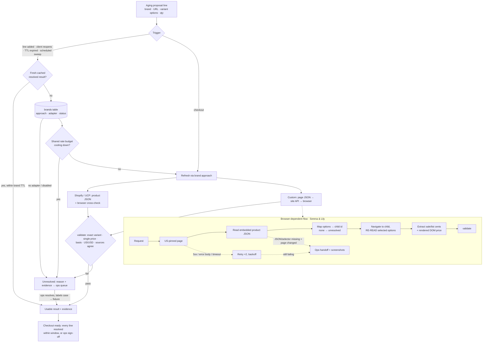

# Design: keeping public product info accurate across ~120 brands

## Notes

**Automate first:** the top 12 brands (80% of volume), whatever their platform. Shopify brands, about 70% of brands, onboard through one generic adapter with config only, which covers the long tail cheaply. Non-Shopify long-tail brands stay manual until their ops cost justifies an adapter.

**Method choice** goes cheapest-first: structured JSON or UCP → site API → browser (cross-checks, sites that block HTTP) → human. Shared: validation, result format, evidence, cache, throttle, probe. Bespoke: variant mapping, selectors, banner meaning.

**Refresh rules:**
- Always fetch fresh before checkout.
- Reuse a cached result within a per-brand TTL.
- A product or variant change invalidates the result.
- A quantity change reuses the unit price, but re-checks quantity breaks.
- Destination matters only for shipping.

**Rate limits and retries:** Shopify throttled us per IP *across stores*, so there is one shared budget with a cooldown. Retry transient errors at most twice; never retry a mismatch.

**Trust:** every result carries source, payload hash, screenshot and observation time. Unresolved when the variant isn't exact, only a range shows, the currency isn't USD, only a conditional price exists, or sources disagree. A resolved result authorizes showing the price and treating the line as verified for the checkout window. It does not authorize a final payable amount or placing an order.

**Models:** there is no LLM in the runtime path. A future model may navigate and click options. It may never type codes, log in, or choose the price, and it must stop on a CAPTCHA or an ambiguous variant.
